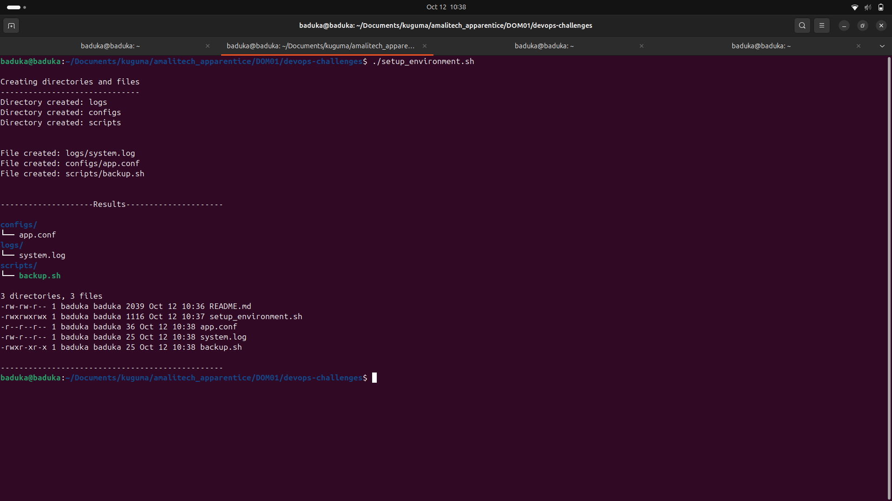
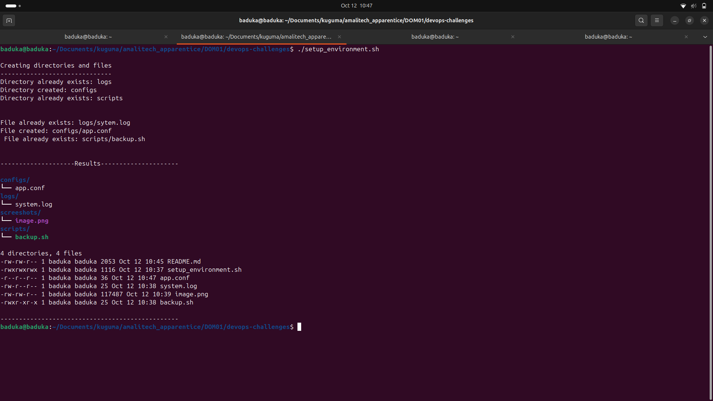
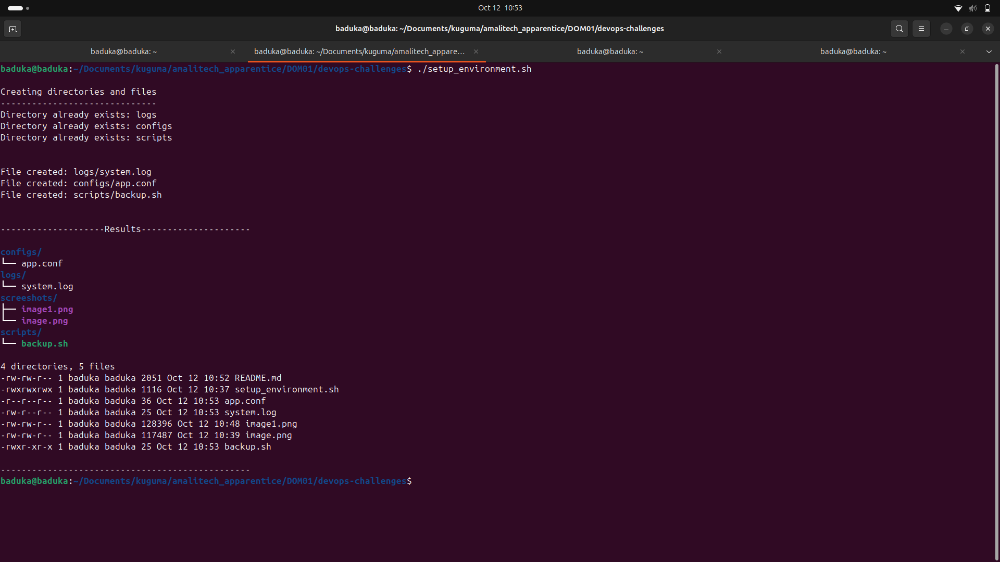

# setup_environment.sh
Bash script that prepares a project skeleton: 3 directories (`logs`, `configs`, `scripts`) and 3 files inside them. Idempotent — existing items are skipped, missing ones are created, then it prints a summary (`tree` + `ls -lR`).

Run: `./setup_environment.sh` (the script has a `#!/bin/bash` shebang and is executable) or `bash setup_environment.sh`

## Permissions
File permissions are enforced on every run, whether the file was just created or already existed:

| File | Mode |
|------|------|
| `logs/system.log` | `644` |
| `configs/app.conf` | `444` |
| `scripts/backup.sh` | `755` |

So if someone changes a file's mode, re-running the script restores it.

## Cases

### 1. First run (nothing exists)
No directories or files present. Script created `logs/`, `configs/`, `scripts/` and all 3 files with their default permissions, then printed the `Results` listing.

### 2. Some directories exist, some missing
`logs/` and `scripts/` already existed, `configs/` was missing. Script skipped the existing ones (`Directory already exists: logs`, `Directory already exists: scripts`) and created `configs/` silently.

### 3. Directories exist, files missing
All 3 directories present but their files were deleted. Script recreated `logs/system.log`, `configs/app.conf`, and `scripts/backup.sh` with permissions `644`, `444`, `755`, no "already exists" messages for files.

### 4. Everything exists, permissions changed
All directories and files present, but file modes were changed (e.g. `chmod 600` on all three). Script reported every item as `already exists` and still reset the files to `644`, `444`, `755`.
